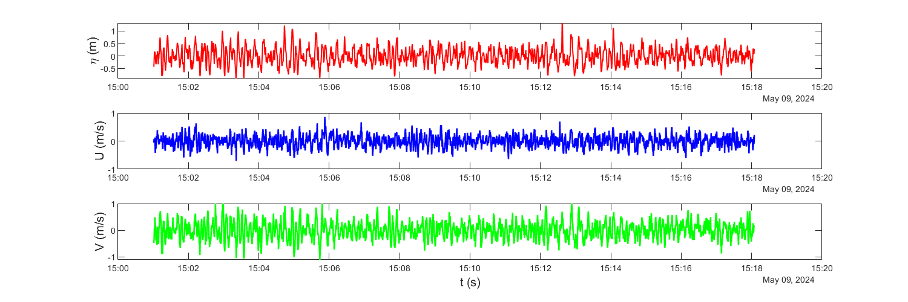
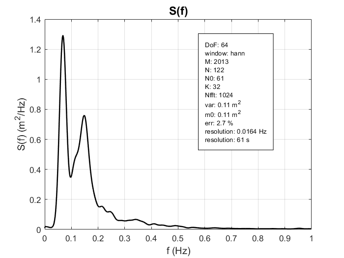
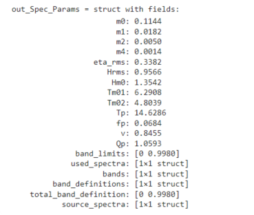
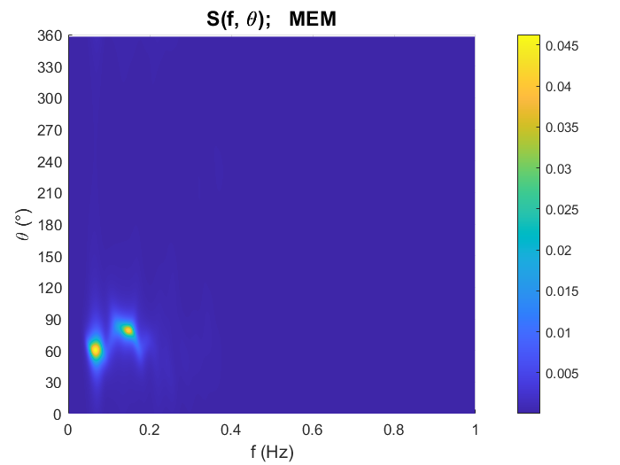
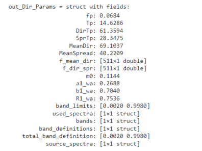

# Wave Spectral Analysis 
[](https://www.mathworks.com/matlabcentral/fileexchange/183891-wave-spectral-analysis)     [](https://doi.org/10.5281/zenodo.20805516) [](https://deepwiki.com/DG28828/waveSpectralAnalysis)   [](https://github.com/DG28828/waveSpectralAnalysis/blob/release/v2.0.0/README.es.md)

MATLAB toolbox for wave spectral and directional analysis. It includes
tools to estimate energy spectra, compute spectral and directional
parameters, reconstruct directional spectra, and process raw data from
AWAC, AQUADOPP, and RBR instruments.

**v2.0.0 (pre-release):** this version extends the instrument workflow of
v1.2.0, which includes only AWAC, with support for AQUADOPP
and RBR and common NetCDF writing and preprocessing functions.

## Features

- Estimation of one-sided energy spectra using the Welch-Bartlett method
  (averaged periodograms with overlap).
- Hydrodynamic correction for pressure signals using the `Kp` factor.
- Computation of spectral parameters for the total spectrum and frequency
  bands.
- Estimation of directional coefficients and directional spectra using a
  truncated Fourier series and the MEM-I method (Lygre & Krogstad).
- Computation of directional parameters by frequency bands.
- Conversion from Cartesian-to convention to nautical-from convention.
- Reading and quality control of AWAC, AQUADOPP, and RBR data, with automatic
  or manual cleaning of bursts (measurement bursts).
- Common NetCDF writing and preprocessing for all three instruments,
  depending on the availability of pressure, orbital velocities, and AST.

## Main functions

### Spectral and directional processing

| Function | Description |
| --- | --- |
| `wsa_spectrum` | Estimates energy spectra for free-surface elevation or pressure. |
| `wsa_spectral_parameters` | Computes total spectral parameters and parameters by frequency bands. |
| `wsa_dirspectrum` | Estimates directional spectra using 2 methods: Truncated Fourier Series (TFS) and MEM-I. |
| `wsa_directional_parameters` | Computes total directional parameters and parameters by frequency bands. |
| `wsa_cartto2nautfrom` | Converts directions to the nautical-from convention. |

### Instrument reading, cleaning, and preprocessing

| Function | Description |
| --- | --- |
| `wsa_awac_read` | Reads raw AWAC data and performs quality control. |
| `wsa_awac_clean` | Cleans AWAC bursts based on quality control or manually. |
| `wsa_aquadopp_read` | Reads raw AQUADOPP data and performs quality control. |
| `wsa_aquadopp_clean` | Cleans AQUADOPP bursts based on quality control or manually. |
| `wsa_rbr_read` | Reads raw RBR data and performs quality control. |
| `wsa_rbr_clean` | Cleans RBR bursts based on quality control or manually. |
| `wsa_nc_write` | Writes raw or cleaned AWAC, AQUADOPP, or RBR data to NetCDF format. |
| `wsa_nc_preprocess` | Identifies the instrument and preprocesses the signals available in the NetCDF file. |

Notes:
- The AWAC workflow has been tested with a first-generation 1 MHz AWAC.
- The AQUADOPP workflow has been tested with AQUADOPP 300 m - Legacy
- The RBR workflow has been tested with RBR solo 3

## Usage Examples

Detailed usage examples are available as .mlx Live Scripts in the \toolbox\examples folder. A summary of the examples is provided below.

### Input Data
Sample data for the example is included in the \toolbox\example_data folder.
```matlab
data = load('..\example_data\burst_data.mat');
AST = data.burst_data.processed.ast(:, 1);                    %Free-surface elevation
U = data.burst_data.processed.velocity_enu(:, 1);             %Orbital velocity in X.
V = data.burst_data.processed.velocity_enu(:, 2);             %Orbital velocity in Y.

fs = data.burst_data.general.fs;                              %Sampling frequency
ast_mean = data.burst_data.general.ast_mean;                  %Mean level measured from the top of the instrument
cell_position = data.burst_data.general.cell_position;        %Distance from the top of the instrument to the orbital velocity measurement cell.
mounting_height = data.burst_data.general.mounting_height;    %Equipment mounting height.

h   = ast_mean + mounting_height;                             %Seafloor depth.                                            
z_v = cell_position - ast_mean;                               %Measurement depth for orbital velocities.
```
<p align="center">
  
</p>


### Energy Spectra
```matlab
[out_Spec, info_Spec] = wsa_spectrum(AST, fs, 'DoF', 64);
f = out_Spec.f;
S = out_Spec.S;
```
<p align="center">
  
</p>

### Spectral Parameters

```matlab
out_Spec_Params = wsa_spectral_parameters(out_Spec)
```
<p align="center">
  
</p>

### Directional Spectra
```matlab
[out_DirSpec, info_DirSpec] = wsa_dirspectrum(AST, U, V, fs, 'SUV', ...
                                             'z_v', z_v, ...
                                             'h', h);
f = out_DirSpec.MEM.f;
theta = out_DirSpec.MEM.theta;
E = out_DirSpec.MEM.E;
```
<p align="center">
  
</p>

### Directional Parameters
```matlab
out_Dir_Params = wsa_directional_parameters(out_DirSpec.MEM)
```
<p align="center">
  
</p>

## Instruments

The workflow consists of reading, burst cleaning, NetCDF writing,
and preprocessing. Reading and cleaning are instrument-specific;
`wsa_nc_write` and `wsa_nc_preprocess` are common to all three.

### AWAC

The toolbox includes functions for working with raw AWAC data:

```matlab
data = wsa_awac_read("...\raw_data\");
data_clean = wsa_awac_clean(data);
mounting_height = 0.50; % Example in m: replace with the actual height above the bottom.
wsa_nc_write(data_clean, "data_clean.nc", 'mounting_height', mounting_height);
info = wsa_nc_preprocess("data_clean.nc");
```

Main functions:

- `wsa_awac_read`: reads decrypted `.hdr`, `.whd`, and `.wad` files, builds a struct with the campaign data, and generates quality-control flags for sea states.
- `wsa_awac_clean`: in automatic mode, removes bursts flagged during reading or allows manual indices to be provided.
- `wsa_nc_preprocess`: for AWAC, corrects and combines AST signals, transforms orbital velocities to geographic ENU axes, filters signals, and adds processed variables to the NetCDF file.

### AQUADOPP

- `wsa_aquadopp_read`: reads `.hdr`, `.dat`, and `.dia` files. Uses the column
  format described in the `.hdr` file and organizes the pressure and
  velocity signals from the `.dia` file into diagnostic bursts. Checks the
  number of samples, instrument orientation, and pressure.
- `wsa_aquadopp_clean`: removes diagnostic bursts based on quality flags
  or manual indices. Preserves the regular records from the `.dat` file,
  which do not correspond one-to-one with the bursts in the `.dia` file.
- `wsa_nc_preprocess`: processes pressure and velocities. Preserves velocities
  if they are already in ENU or transforms them from BEAM when the
  transformation matrix and orientation are available.
  Transformation from XYZ is not implemented.


```matlab
data = wsa_aquadopp_read("...\aquadopp_data\");
data_clean = wsa_aquadopp_clean(data);
mounting_height = 0.50; % Example in m: replace with the actual height above the bottom.
wsa_nc_write(data_clean, "aquadopp_clean.nc", 'mounting_height', mounting_height);
info = wsa_nc_preprocess("aquadopp_clean.nc");
```

**Note:** reading sets diagnostic sampling to 1 Hz.
Preprocessing calculates the velocity cell position
as `blanking_distance + 1.5 * 0.75` m. This configuration is associated with the AQUADOPP model used (AQUADOPP 300 m - Legacy); when using data from another model, the corresponding changes must be made.

### RBR

- `wsa_rbr_read`: reads a pair of `*_metadata.txt` and `*_burst.txt` files
  exported by Ruskin, with the same base name. The metadata file
  must be JSON, and the burst file must begin with the columns
  `Time,Burst,Pressure`. Pressure is imported in dbar as absolute pressure.
  The number of samples, the time interval within each burst,
  and pressure quality are checked.
- `wsa_rbr_clean`: removes bursts based on quality flags or manual
  indices. In this version, it takes the struct generated by `wsa_rbr_read`;
  reconstructing it from a NetCDF file is not supported.
- `wsa_nc_preprocess`: converts absolute pressure to gauge pressure by
  subtracting the atmospheric pressure stored in the Ruskin metadata,
  calculates depth, and preprocesses the pressure signal. Uses the density
  from Ruskin when available; otherwise, it uses 1025 kg/m³.

The `*_data.txt`, `*_events.txt`, and `*_wave.txt` files are not used, nor is
the derived `Wave` column in the burst file. This RBR workflow uses
pressure only: it supports spectral analysis, but cannot provide directional
estimation on its own, as neither orbital velocities nor AST are available.

```matlab
data = wsa_rbr_read("...\rbr_data\");
data_clean = wsa_rbr_clean(data);
mounting_height = 0.50; % Example in m: replace with the actual height above the bottom.
wsa_nc_write(data_clean, "rbr_clean.nc", 'mounting_height', mounting_height);
info = wsa_nc_preprocess("rbr_clean.nc");
```

Times are read as they appear in the export. The Ruskin UTC offset
is preserved as metadata, but is not automatically applied when
writing the NetCDF file. To obtain correct UTC times in this workflow,
use an export with dates already expressed in UTC.

### Common writing and preprocessing

- The `wsa_*_clean` functions remove entire bursts; they do not correct
  samples within each burst. Automatic mode uses the flags
  generated by the corresponding reader. For manual cleaning, use
  `'man', true` and `'clean_idx', indices`.
- `wsa_nc_write` identifies the instrument from the struct and saves
  signals, metadata, and quality flags. Supports `'site_name'`,
  `'campaign_name'`, `'mounting_height'`, and `'overwrite'`. Mounting height
  is expressed in meters above the bottom and is required to obtain
  a valid depth `h`. By default, an existing NetCDF file is overwritten;
  this can be prevented with `'overwrite', false`.
- `wsa_nc_preprocess` identifies the instrument through the
  `instrument_type` attribute, removes the mean and trend, processes
  the available signals, and writes the results to the same NetCDF file.
  It also returns the `info` struct. Variables that do not apply to the
  instrument are stored with fill values, and their availability is indicated
  through attributes.

By default, a filter from 1/30 to 1/2 Hz is applied, and IG signals
filtered between 1/300 and 1/30 Hz are generated. The `'filter_flag'`,
`'IG_filter_flag'`, and `'ast_corr_flag'` options allow these operations to be
controlled; AST correction is only performed if AST measurements are available.
To retain content outside the 1/30 to 1/2 Hz band in the processed signals,
use `'filter_flag', false`; mean and trend removal are still performed.
The default filtering up to 1/2 Hz requires a sampling rate of at least 1 Hz.


### Migration from v1.2.0

- Replace `wsa_awac_nc_write` with `wsa_nc_write` and
  `wsa_awac_preprocess` with `wsa_nc_preprocess` in existing scripts.
  The previous names are no longer included in this version.
- Instrument functions are now located in
  `toolbox/io_instruments`; update manually configured paths
  or add `toolbox` with all its subfolders again.
- NetCDF files generated by v1.2.0 are not directly compatible with the
  new preprocessor: attributes such as `instrument_type` are missing, and
  sampling and coordinate metadata names have changed. Export them again
  from the raw or cleaned data using `wsa_nc_write` before preprocessing.

## Requirements

- MATLAB. The toolbox has been tested with MATLAB R2024b.
- Signal Processing Toolbox.
- MATLAB NetCDF functions.

## Installation

Three installation options are shown below. Options 1 or 2 are recommended,
because the `.mltbx` toolbox file automatically resolves the function paths.

### 1) From MATLAB File Exchange (Not available for this version)

In MATLAB, go to the Home tab and open Get Add-Ons. Search for the toolbox as
Wave Spectral Analysis and install it, or download the `.mltbx` toolbox file.
Using this method downloads the latest release published on GitHub.

### 2) From the GitHub release

Download the release of interest, then run the `.mltbx` toolbox file or use the
source code. In the second case, the functions must be added to the path as
described in option 3.

### 3) Downloading the source code

Clone or download the repository and add the `toolbox` folder, including all its
subfolders, to the MATLAB path:

```matlab
addpath(genpath("...\waveSpectralAnalysis\toolbox"))
```

To verify that the path was correctly configured:

```matlab
which wsa_spectrum
which wsa_psdwb
```

Both commands should return paths inside the `toolbox` folder.

**Note:** For version v2.0.0, you must switch to the release/v2.0.0 branch.

## Conventions and notes

- Frequencies are expressed in Hz.
- Sensor depths below the mean water level are indicated with a negative sign,
  for example `z_p = -0.5`.
- In `wsa_spectrum`, the signal is preprocessed by removing the mean and trend
  before estimating the spectrum.
- In the directional analysis, the zero-frequency component is excluded from the
  directional analysis.
- The directions from `wsa_dirspectrum` and `wsa_directional_parameters` use the
  Cartesian-to convention by default: positive angles are measured from the
  positive X-axis in the counterclockwise direction.
- It is assumed that the input X and Y orbital velocities correspond to the
  geographic East and North coordinates, respectively, with positive values
  measured toward the East and North.

## License

This project is distributed under the license included in `LICENSE`.
